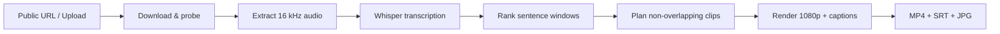

# ClipForge

**Turn long videos into ranked, captioned clips — automatically.**

ClipForge is a self-hosted AI clipping studio. Give it a public video URL or an upload up to 2 GB / 2 hours, and it transcribes the audio with word-level timestamps, ranks the strongest sentence-aligned moments, and renders ready-to-publish clips in 9:16, 1:1, or 16:9 with burned-in captions, an SRT sidecar, and a thumbnail.

[](https://nodejs.org/)
[](https://nextjs.org/)
[](#license)

## Highlights

- **Any source, one workflow** — paste a public link or upload MP4, MOV, WebM, MKV, M4V, or AVI (up to 2 GB / 2 hours).
- **Transcript-aware selection** — word-level timestamps are grouped into sentence-aligned windows, then ranked by hook language, keyword density, speaking pace, emotional language, and length fit.
- **Deterministic ranking** — the same transcript always produces the same selection. No external AI API, no per-run cost, no drift.
- **Up to 10 non-overlapping clips** per job, with configurable clip length bounds.
- **Publish-ready exports** — 1080p MP4 with burned-in captions, matching SRT, and JPEG thumbnail for every clip.
- **Three aspect ratios** — vertical 9:16, square 1:1, and widescreen 16:9, using a center crop, a blurred fill, or a random mix per clip.
- **Karaoke captions with custom colors** — bold, clean, boxed, and karaoke presets. Karaoke highlights each spoken word on vertical or widescreen clips; text and active-word colors are configurable per job.
- **Multilingual transcription** — auto-detect plus 13 selectable languages, including a dedicated Khmer model path with Khmer font shaping and line wrapping.
- **Production-minded pipeline** — SQLite-backed job queue, atomic claiming, stale-lock recovery, retry limits, and live stage progress in the studio.
- **Local-first** — media processing runs on your machine or your own server. Browser uploads, and optionally rendered clips, can be stored in Vercel Blob.

## How it works



The worker claims a queued job, downloads or fetches the source, extracts mono 16 kHz audio with ffmpeg, and transcribes it with faster-whisper. Transcript windows are scored locally, the highest-scoring non-overlapping moments are selected, and each moment is center-cropped or blur-filled, captioned with ASS, and encoded with libx264. Progress is written back to SQLite and reflected on the job page.

## Tech stack

| Layer | Technology |
| --- | --- |
| Web app | Next.js 16 (App Router), React 19, Tailwind CSS 4 |
| UI | Base UI, shadcn-style primitives, Lucide icons |
| Data | SQLite via libSQL, Drizzle ORM |
| Worker | Node.js ESM, yt-dlp, ffmpeg / ffprobe |
| Transcription | faster-whisper (CT2 int8), OpenAI Whisper CLI fallback |
| Exports | ffmpeg, libass (ASS/SRT), JPEG thumbnails |
| Deployment | Docker, Render Blueprint (`render.yaml`) |

## Getting started

### Prerequisites

- Node.js **24 or newer**
- ffmpeg and ffprobe on your `PATH`
- Python 3.10+ with pip

### Install

```bash
git clone https://github.com/COPYProgrammer168/clipforge.git
cd clipforge
npm install
python -m pip install faster-whisper yt-dlp
```

Create your local environment file:

```bash
cp .env.example .env.local
```

On Windows PowerShell, use `Copy-Item .env.example .env.local`.

Create the SQLite schema and start the app:

```bash
npm run db:push
npm run dev
```

Open [http://localhost:3000](http://localhost:3000).

`npm run dev` starts the Next.js app and the background worker together. The first transcription downloads the selected Whisper model into the Hugging Face cache, so expect a delay on the first job.

If faster-whisper is not installed, the pipeline falls back to the `whisper` CLI (`python -m whisper`), which must be installed separately.

## Configuration

Copy `.env.example` to `.env.local` and adjust as needed. All worker variables are optional.

| Variable | Default | Purpose |
| --- | --- | --- |
| `DATABASE_URL` | `file:./clipforge.db` | SQLite file used by the app, worker, and drizzle-kit. Use a `libsql://` URL for hosted libSQL/Turso. |
| `DATABASE_AUTH_TOKEN` | unset | Auth token for hosted libSQL/Turso. |
| `BLOB_READ_WRITE_TOKEN` | unset | Vercel Blob token for browser uploads and Blob clip publishing. Not required for URL jobs with local clips. |
| `WHISPER_MODEL` | `base` | faster-whisper model: `tiny`, `base`, `small`, `medium`, `large-v3`. |
| `WHISPER_MODEL_KM` | `.models/faster-whisper-base-khmer` | Optional CT2 folder for the fine-tuned Khmer model. If missing, Khmer jobs use `WHISPER_MODEL`. |
| `POLL_SECONDS` | `3` | Queue poll interval. |
| `WORK_ROOT` | `.work/jobs` | Scratch directory for downloads and extracted audio; cleaned after each job. |
| `CLIPS_ROOT` | `public/clips` | Where rendered clips are written and served from in local mode. |
| `CLIP_STORAGE` | `local` | `local` writes clips to `CLIPS_ROOT`; `blob` publishes the MP4, SRT, and JPEG to Vercel Blob (requires `BLOB_READ_WRITE_TOKEN`). |
| `WORKER_DISABLED` | unset | Set to `1` to skip the worker in `npm run start:render` (web-only hosting; run the worker elsewhere). |
| `DB_AUTO_SETUP` | `1` | `start:render` applies Drizzle migrations before starting. Set to `0` to skip it. |
| `MIN_CLIP_SECONDS` | `16` | Minimum clip length. |
| `MAX_CLIP_SECONDS` | `52` | Maximum clip length. |
| `TARGET_CLIP_SECONDS` | `30` | Preferred clip length used during ranking. |

## Scripts

| Command | Description |
| --- | --- |
| `npm run dev` | Start the web app and worker together. |
| `npm run dev:next` | Start only the Next.js dev server. |
| `npm run worker` | Start only the background worker. |
| `npm run build` | Production build. |
| `npm run start` | Start the production web server. |
| `npm run start:render` | Sync the schema, then start web and worker together in production (used by the Render image; set `WORKER_DISABLED=1` for web only). |
| `npm run db:push` | Push the Drizzle schema to the configured database (development). |
| `npm run db:migrate` | Apply committed Drizzle migrations to the configured database. |
| `npm run db:studio` | Open Drizzle Studio. |
| `npm run model:khmer` | Convert the fine-tuned Khmer Whisper model to CT2 int8 under `.models/`. |
| `npm run lint` | Run ESLint. |
| `npm run typecheck` | Run the TypeScript compiler. |
| `npm run check` | Lint, typecheck, and build. |

## Project layout

```text
src/
  app/(site)/            Marketing pages
  app/studio/            Studio dashboard and job pages
  app/api/jobs/          Job creation, listing, and deletion
  app/api/blob/upload/   Browser upload endpoint
  app/clips/[...path]/   Clip media streaming (Range support)
  components/            Site and studio UI
  lib/db/                Drizzle schema and libSQL client
  lib/                   Plans, job helpers, content
drizzle/                 Committed SQL migrations
scripts/
  worker.mjs             Queue worker and job orchestration
  migrate.mjs            Applies Drizzle migrations at startup
  pipeline/              Media, transcription, scoring, captions, rendering
  dev-all.mjs            Local web + worker supervisor
  render-start.mjs       Production web + optional worker supervisor
Dockerfile               Node, ffmpeg, Python, Whisper, fonts
render.yaml              Render Blueprint (free web, Turso, Blob)
```

## Deploying to Render

The repository includes a Dockerfile and a Render Blueprint. The image bundles Node 24, ffmpeg, Python, faster-whisper, yt-dlp, and the Liberation/Noto font set used for captions.

`render.yaml` targets Render Free: one web-only Docker service with Turso/libSQL and Vercel Blob. Free web services have an ephemeral filesystem and cannot attach a persistent disk, so SQLite-on-disk is not an option there.

1. Create a free Turso database and a Vercel Blob store:
   ```bash
   turso db create clipforge
   turso db show clipforge --url
   turso db tokens create clipforge
   ```
2. Push the repository to GitHub.
3. In Render, choose **New → Blueprint** and select the repository. Render reads `render.yaml` and provisions a single Free web service. The disk block is intentionally absent.
4. Set `DATABASE_URL`, `DATABASE_AUTH_TOKEN`, and `BLOB_READ_WRITE_TOKEN` when Render prompts for the `sync: false` variables. If the service already exists, replace any old `file:/var/data/...` database value in the dashboard.
5. Deploy. `node scripts/render-start.mjs` applies the Drizzle migrations before starting Next.js, so a new Turso database is initialized automatically. No Render Shell is required.
6. Run the worker on your machine with the same database and Blob credentials:
   ```bash
   CLIP_STORAGE=blob
   WORK_ROOT=.work/jobs
   npm run worker
   ```
   On Windows PowerShell, set the same values with `$env:CLIP_STORAGE="blob"` and `$env:WORK_ROOT=".work/jobs"` first.

The web service runs with `WORKER_DISABLED=1` because Render Free provides only 512 MB of RAM and sleeps when idle. Jobs stay queued in Turso until the worker is running. Rendered clips go to Vercel Blob, so they survive web redeploys and sleep cycles.

### Paid disk alternative

For a single-container deployment, upgrade the Render service to a disk-capable paid plan (for example `1c-2g`), attach a disk at `/var/data`, and set `DATABASE_URL=file:/var/data/clipforge.db`, `WORK_ROOT=/var/data/work`, `CLIPS_ROOT=/var/data/clips`, and `CLIP_STORAGE=local`. Remove `WORKER_DISABLED` to run the worker in the same container. A disk prevents zero-downtime deploys and limits the service to one instance.

Rendered clips are uploaded as public Blob objects and removed when the job is deleted. Vercel's Hobby plan is non-commercial and Blob storage/transfer is limited; use paid hosting for production traffic.

## Operational notes

- Framing is a center crop or a blurred fill; there is no face tracking or keyframe pass. Check the crop when the subject sits off-center.
- Clip selection is deterministic and fully offline; changing clip length bounds or transcript quality changes the result.
- Public-link downloads rely on yt-dlp. Some platforms and datacenter IPs may require cookies or a JavaScript runtime, and extractors can break when sites change.
- Uploads are capped at 2 GB and sources at 2 hours. Deleting a job removes its rendered files.
- The worker uses a single libSQL database (local SQLite or Turso) and a local clip store by default. For Render Free, use hosted libSQL and `CLIP_STORAGE=blob`; workers share the job queue through atomic claims.
- Blob-published clips use public Vercel Blob URLs.

## License

Released under the MIT License. See `package.json` for details.
