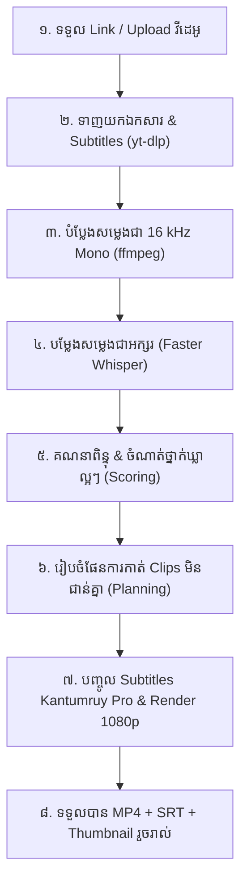

# ClipForge

**Turn long videos into ranked, captioned clips — automatically.**

ClipForge is a self-hosted AI clipping studio. Give it a public video URL or an upload up to 2 GB / 2 hours, and it transcribes the audio with word-level timestamps, ranks the strongest sentence-aligned moments, and renders ready-to-publish clips in 9:16, 1:1, 16:9, or a random mix per clip with burned-in captions, an SRT sidecar, and a thumbnail.

[](https://nodejs.org/)
[](https://nextjs.org/)
[](#license)

## Highlights

- **Any source, one workflow** — paste a public link or upload MP4, MOV, WebM, MKV, M4V, or AVI (up to 2 GB / 2 hours).
- **Transcript-aware selection** — word-level timestamps are grouped into sentence-aligned windows, then ranked by hook language, keyword density, speaking pace, emotional language, and length fit.
- **Deterministic ranking** — the same transcript always produces the same selection. No external AI API, no per-run cost, no drift.
- **Up to 10 non-overlapping clips** per job, with fixed or random clip lengths.
- **Publish-ready exports** — 1080p MP4 with burned-in captions, matching SRT, and JPEG thumbnail for every clip.
- **Flexible framing** — vertical 9:16, square 1:1, widescreen 16:9, or a random ratio per clip, using a center crop, a blurred fill, a webcam split when a facecam is detected, or a random background mix.
- **Karaoke captions with custom colors** — bold, clean, boxed, and karaoke presets, plus a random per-clip style and small, medium, or large text. Karaoke highlights each spoken word; text and active-word colors are configurable per job.
- **English and Khmer transcription** — the studio offers English and Khmer. Khmer uses a dedicated fine-tuned model with Khmer font shaping and line wrapping; English falls back to the base Whisper model.
- **Production-minded pipeline** — SQLite-backed job queue, atomic claiming, stale-lock recovery, retry limits, and live stage progress in the studio.
- **Local-first** — media processing runs on your machine or your own server. Browser uploads and rendered clips can be stored in Cloudflare R2 (or Vercel Blob).

## How it works


The worker claims a queued job, downloads or fetches the source, extracts mono 16 kHz audio with ffmpeg, and transcribes it with faster-whisper. Transcript windows are scored locally, the highest-scoring non-overlapping moments are selected, and each moment is center-cropped, blur-filled, or split into a detected webcam above the gameplay, captioned with ASS, and encoded with libx264. Progress is written back to SQLite and reflected on the job page.

## Tech stack

| Layer | Technology |
| --- | --- |
| Web app | Next.js 16 (App Router), React 19, Tailwind CSS 4 |
| UI | Base UI, shadcn-style primitives, Lucide icons |
| Data | SQLite via libSQL, Drizzle ORM |
| Worker | Node.js ESM, yt-dlp, ffmpeg / ffprobe |
| Transcription | faster-whisper (CT2 int8), OpenAI Whisper CLI fallback |
| Exports | ffmpeg, libass (ASS/SRT), JPEG thumbnails |
| Deployment | Docker, Render Blueprint (`render.yaml`) |

## Getting started

### Prerequisites

- Node.js **24 or newer**
- ffmpeg and ffprobe on your `PATH`
- Python 3.10+ with pip

### Install

```bash
git clone https://github.com/COPYProgrammer168/clipforge.git
cd clipforge
npm install
python -m pip install faster-whisper yt-dlp opencv-python-headless
```

Create your local environment file:

```bash
cp .env.example .env.local
```

On Windows PowerShell, use `Copy-Item .env.example .env.local`.

Create the SQLite schema and start the app:

```bash
npm run db:push
npm run dev
```

Open [http://localhost:3000](http://localhost:3000).

`npm run dev` starts the Next.js app and the background worker together. The first transcription downloads the selected Whisper model into the Hugging Face cache, so expect a delay on the first job.

If faster-whisper is not installed, the pipeline falls back to the `whisper` CLI (`python -m whisper`), which must be installed separately. If OpenCV is not installed, webcam detection is skipped and those clips use standard framing.

## Configuration

Copy `.env.example` to `.env.local` and adjust as needed. All worker variables are optional.

| Variable | Default | Purpose |
| --- | --- | --- |
| `DATABASE_URL` | `file:./clipforge.db` | SQLite file used by the app, worker, and drizzle-kit. Use a `libsql://` URL for hosted libSQL/Turso. |
| `DATABASE_AUTH_TOKEN` | unset | Auth token for hosted libSQL/Turso. |
| `R2_ACCOUNT_ID` | unset | Cloudflare account ID from the R2 S3 endpoint (`https://<ACCOUNT_ID>.r2.cloudflarestorage.com`). |
| `R2_ACCESS_KEY_ID` | unset | Access Key ID from an R2 API token. |
| `R2_SECRET_ACCESS_KEY` | unset | Secret Access Key from an R2 API token. |
| `R2_BUCKET` | unset | R2 bucket name. |
| `R2_PUBLIC_BASE_URL` | unset | Public bucket URL (`r2.dev` or custom domain), without a trailing slash. |
| `BLOB_READ_WRITE_TOKEN` | unset | Legacy Vercel Blob token, only when `CLIP_STORAGE=blob`. |
| `WHISPER_MODEL` | `base` | faster-whisper model: `tiny`, `base`, `small`, `medium`, `large-v3`. |
| `WHISPER_MODEL_KM` | `.models/faster-whisper-base-khmer` | Optional CT2 folder for the fine-tuned Khmer model. If missing, Khmer jobs use `WHISPER_MODEL`. |
| `POLL_SECONDS` | `3` | Queue poll interval. |
| `WORK_ROOT` | `.work/jobs` | Scratch directory for downloads and extracted audio; cleaned after each job. |
| `CLIPS_ROOT` | `public/clips` | Where rendered clips are written and served from in local mode. |
| `CLIP_STORAGE` | `local` | `local` writes clips to `CLIPS_ROOT`; `r2` publishes uploads and clips to Cloudflare R2; `blob` is the legacy Vercel Blob mode. |
| `WORKER_DISABLED` | unset | Set to `1` to skip the worker in `npm run start:render` (web-only hosting; run the worker elsewhere). |
| `DB_AUTO_SETUP` | `1` | `start:render` applies Drizzle migrations before starting. Set to `0` to skip it. |
| `MIN_CLIP_SECONDS` | `16` | Minimum clip length. |
| `MAX_CLIP_SECONDS` | `52` | Maximum clip length. |
| `TARGET_CLIP_SECONDS` | `30` | Preferred clip length used during ranking. |

The studio also exposes **Clip time** presets per job: Auto uses the env bounds above, Short targets roughly 10–25 seconds, Long targets roughly 40–90 seconds, and Random mixes targets across the clips.

## Scripts

| Command | Description |
| --- | --- |
| `npm run dev` | Start the web app and worker together. |
| `npm run dev:next` | Start only the Next.js dev server. |
| `npm run worker` | Start only the background worker. |
| `npm run build` | Production build. |
| `npm run start` | Start the production web server. |
| `npm run start:render` | Sync the schema, then start web and worker together in production (used by the Render image; set `WORKER_DISABLED=1` for web only). |
| `npm run db:push` | Push the Drizzle schema to the configured database (development). |
| `npm run db:migrate` | Apply committed Drizzle migrations to the configured database. |
| `npm run db:studio` | Open Drizzle Studio. |
| `npm run model:khmer` | Convert the fine-tuned Khmer Whisper model to CT2 int8 under `.models/`. |
| `npm run lint` | Run ESLint. |
| `npm run typecheck` | Run the TypeScript compiler. |
| `npm run check` | Lint, typecheck, and build. |

## Project layout

```text
src/
  app/(site)/            Marketing pages
  app/studio/            Studio dashboard and job pages
  app/api/jobs/          Job creation, listing, and deletion
  app/api/blob/upload/   Browser upload endpoint
  app/clips/[...path]/   Clip media streaming (Range support)
  components/            Site and studio UI
  lib/db/                Drizzle schema and libSQL client
  lib/                   Plans, job helpers, content
drizzle/                 Committed SQL migrations
scripts/
  worker.mjs             Queue worker and job orchestration
  migrate.mjs            Applies Drizzle migrations at startup
  pipeline/              Media, transcription, scoring, captions, rendering
  dev-all.mjs            Local web + worker supervisor
  render-start.mjs       Production web + optional worker supervisor
Dockerfile               Node, ffmpeg, Python, Whisper, OpenCV, fonts
render.yaml              Render Blueprint (free web, Turso, R2)
```

## Deploying to Render

The repository includes a Dockerfile and a Render Blueprint. The image bundles Node 24, ffmpeg, Python, faster-whisper, yt-dlp, OpenCV for facecam detection, and the Liberation/Noto font set used for captions.

`render.yaml` targets Render Free: one web-only Docker service with Turso/libSQL and Cloudflare R2. Free web services have an ephemeral filesystem and cannot attach a persistent disk, so SQLite-on-disk is not an option there.

1. Create a free Turso database:
   ```bash
   turso db create clipforge
   turso db show clipforge --url
   turso db tokens create clipforge
   ```
2. Create an R2 bucket named `clipforge` in the Cloudflare dashboard. Under the bucket's **Settings**, enable **Public access** using the `r2.dev` URL or a custom domain, then copy that public base URL (for example `https://pub-xxxxxxxx.r2.dev`).
3. Create an R2 API token under **R2 → Manage R2 API Tokens**. Give it **Object Read & Write** permission scoped to the bucket, then copy the **Access Key ID** and **Secret Access Key**. The S3 endpoint is `https://<ACCOUNT_ID>.r2.cloudflarestorage.com`; set `R2_ACCOUNT_ID` to the `<ACCOUNT_ID>` part (a full S3 endpoint URL is also accepted), and set `R2_BUCKET` to `clipforge`.
4. Add a CORS policy to the R2 bucket so the browser can upload directly:
   ```json
   [
     {
       "AllowedOrigins": [
         "https://clipforge-2tng.onrender.com",
         "http://localhost:3000"
       ],
       "AllowedMethods": ["GET", "HEAD", "PUT"],
       "AllowedHeaders": ["content-type"],
       "ExposeHeaders": ["etag"],
       "MaxAgeSeconds": 3600
     }
   ]
   ```
5. Push the repository to GitHub. In Render, choose **New → Blueprint** and select the repository. Render reads `render.yaml` and provisions a single Free web service. The disk block is intentionally absent.
6. Set `DATABASE_URL`, `DATABASE_AUTH_TOKEN`, `R2_ACCOUNT_ID`, `R2_ACCESS_KEY_ID`, `R2_SECRET_ACCESS_KEY`, `R2_BUCKET`, and `R2_PUBLIC_BASE_URL` when Render prompts for the `sync: false` variables. If the service already exists, replace any old `file:/var/data/...` database value in the dashboard.
7. Deploy. `node scripts/render-start.mjs` applies the Drizzle migrations before starting Next.js, so a new Turso database is initialized automatically. No Render Shell is required.
8. Run the worker on your machine with the same database and R2 credentials:
   ```bash
   CLIP_STORAGE=r2
   WORK_ROOT=.work/jobs
   npm run worker
   ```
   On Windows PowerShell, set the same values with `$env:CLIP_STORAGE="r2"` and `$env:WORK_ROOT=".work/jobs"` first.

The web service runs with `WORKER_DISABLED=1` because Render Free provides only 512 MB of RAM and sleeps when idle. Jobs stay queued in Turso until the worker is running. Uploads and rendered clips go to R2, so they survive web redeploys and sleep cycles.

### Paid disk alternative

For a single-container deployment, upgrade the Render service to a disk-capable paid plan (for example `1c-2g`), attach a disk at `/var/data`, and set `DATABASE_URL=file:/var/data/clipforge.db`, `WORK_ROOT=/var/data/work`, `CLIPS_ROOT=/var/data/clips`, and `CLIP_STORAGE=local`. Remove `WORKER_DISABLED` to run the worker in the same container. A disk prevents zero-downtime deploys and limits the service to one instance.

Uploads and rendered clips are stored as public R2 objects and removed when the job is deleted. R2 has a free tier and no egress fees; check Cloudflare's current limits for production traffic.

## Operational notes

- Framing is a center crop, a blurred fill, or a webcam split when a facecam is detected. Detection is a heuristic pass over sampled frames, not frame-by-frame tracking; check the crop when the facecam sits near the center or moves during the clip.
- Clip selection is deterministic and fully offline; changing clip length bounds or transcript quality changes the result.
- Public-link downloads rely on yt-dlp. Some platforms and datacenter IPs may require cookies or a JavaScript runtime, and extractors can break when sites change.
- Uploads are capped at 2 GB and sources at 2 hours. Uploaded sources are removed after a successful job; deleting a job removes its rendered files and any remaining source.
- The worker uses a single libSQL database (local SQLite or Turso) and a local clip store by default. For Render Free, use hosted libSQL and `CLIP_STORAGE=r2`; workers share the job queue through atomic claims.
- Remote clips use public Cloudflare R2 URLs (or Vercel Blob URLs when `CLIP_STORAGE=blob`).

## ឯកសារណែនាំជាភាសាខ្មែរ (Khmer Documentation)

### ១. សេចក្តីផ្តើមអំពីគម្រោង (Project Introduction)
**ClipForge** គឺជាប្រព័ន្ធស្វ័យប្រវត្តិកាត់វីដេអូខ្លីៗ (Video Clipping Studio) ដែលដំណើរការដោយ AI នៅលើម៉ាស៊ីនផ្ទាល់ខ្លួន (Self-hosted)។ ClipForge ជួយសម្រួលដល់ការទាញយកវីដេអូវែងៗពី YouTube ឬឯកសារ Upload (រហូតដល់ 2 GB / 2 ម៉ោង) ហើយបម្លែងទៅជាវីដេអូខ្លីៗកម្រិត 1080p (ទម្រង់ 9:16 សម្រាប់ TikTok/Reels/Shorts, 1:1, ឬ 16:9) រហូតដល់ ១០ clips ក្នុងមួយវីដេអូ ដោយមានភ្ជាប់មកជាមួយចំណងជើងរត់ស្វ័យប្រវត្តិ (Burned-in Captions / Karaoke Subtitles), ឯកសារ `.srt`, និងរូបភាពតំណាង (Thumbnail)។

---

### ២. កូដភាសា និងការកំណត់ (Language Codes & Models)

| កូដភាសា (Code) | ឈ្មោះភាសា | ម៉ូដែល AI (Transcription Model) | លក្ខណៈពិសេស |
| :--- | :--- | :--- | :--- |
| **`en`** *(Default)* | ភាសាអង់គ្លេស (English) | Faster Whisper Base | គាំទ្រការចាប់ពាក្យកម្រិត Word-level Timestamps យ៉ាងរហ័ស និងត្រឹមត្រូវ។ ត្រូវបានកំណត់ជាភាសាលំនាំដើម (Default) នៅក្នុងផ្ទាំងបង្កើត Job។ |
| **`km`** | ភាសាខ្មែរ (Khmer) | Fine-tuned Khmer Whisper (`.models/faster-whisper-base-khmer`) | ម៉ូដែលបណ្តុះបណ្តាលពិសេសសម្រាប់ភាសាខ្មែរ។ ប្រើប្រាស់ប្រព័ន្ធកាត់ពាក្យវចនានុក្រម ICU `Intl.Segmenter` និងពុម្ពអក្សរ **Kantumruy Pro** ផ្លូវការ។ |
| **`auto`** | រកឃើញស្វ័យប្រវត្តិ | Language Auto-Detection | ពិនិត្យសម្លេងជាមុន បើរកឃើញសម្លេងខ្មែរ វានឹងរត់ទៅកាន់ម៉ូដែលខ្មែរដោយស្វ័យប្រវត្តិ។ |

- **Subtitles ពី YouTube**: ប្រព័ន្ធនឹងទាញយក Subtitles ជាភាសាខ្មែរ (`km`, `km-orig`) និងអង់គ្លេស (`en`, `en-orig`) ដោយស្វ័យប្រវត្តិ ប្រសិនបើមាននៅលើ YouTube។

---

### ៣. ដំណើរការដំណើរការការងារ (Processing Pipeline)



1. **ការទាញយកប្រភព (Ingestion)**: ប្រើប្រាស់ `yt-dlp` ដើម្បីទាញយកវីដេអូ និងឯកសារ auto-subtitles (`km`, `en`)។
2. **ការទាញយកសម្លេង (Audio Extraction)**: `ffmpeg` ទាញយកសម្លេងជាទម្រង់ 16 kHz mono WAV សម្រាប់ Whisper។
3. **ការបម្លែងជាអក្សរ (Transcription)**:
   - ប្រើប្រាស់ `faster-whisper` ដែលមាន int8 quantization រត់លើ CPU/GPU យ៉ាងរហ័ស។
   - សម្រាប់ភាសាខ្មែរ ប្រព័ន្ធកំណត់ `hallucination_silence_threshold=2.0` និង `repetition_penalty=1.35` ដើម្បីកម្ចាត់បញ្ហា AI និយាយដដែលៗ។
   - កាត់ពាក្យដោយ `Intl.Segmenter("km", { granularity: "word" })` មិនឱ្យបែកបាក់ព្យញ្ជនៈ ឬជើងអក្សរឡើយ។
4. **ការដាក់ពិន្ទុ (Hook & Highlight Scoring)**: ក្បួនដោះស្រាយ (Algorithm) វាយតម្លៃលើ Hook, ពាក្យគន្លឹះ, ល្បឿននិយាយ, និងអារម្មណ៍ ដើម្បីជ្រើសរើសឃ្លាដែលទាក់ទាញបំផុត។
5. **ការកាត់ត និងរចនាអក្សរ (Video Rendering & Subtitle Burning)**:
   - `ffmpeg` បញ្ចូល Subtitles តាមរយៈ ASS filter ដោយប្រើពុម្ពអក្សរ **Kantumruy Pro / Kantumruy** ពីថត `fonts/`។
   - កំណត់ចំនួនបន្ទាត់អតិបរមាត្រឹម ២ បន្ទាត់ (`MAX_CAPTION_LINES = 2`) មិនឱ្យបាំងផ្ទៃមុខ ឬរូបភាពវីដេអូ។
   - គាំទ្រម៉ូដ Karaoke ដែលពាក្យនីមួយៗភ្លឺពណ៌តាមចង្វាក់និយាយ។

---

### ៤. ការត្រួតពិនិត្យគុណភាព និងសំណួរ-ចម្លើយ (QA & Troubleshooting)

**សំណួរទី ១៖ ហេតុអ្វីបានជាអក្សរខ្មែរពីមុនចេញពាក្យដដែលៗ (ដូចជា `វ៉ៃវ៉ៃវ៉ៃ...` ឬ `របស់អត់ចានរបស់អត់ចាន...`)?**
- **មូលហេតុ**៖ ម៉ូដែល Whisper fine-tune សម្រាប់ភាសាតិចតួច (Low-resource language) អាចជួបប្រទះបញ្ហាច្រំដែល (Hallucination loop) នៅពេលចំកន្លែងភ្លេង ឬកន្លែងស្ងាត់។
- **ដំណោះស្រាយ**៖ យើងបានបន្ថែម `hallucination_silence_threshold: 2.0`, `repetition_penalty: 1.35`, និងកូដសម្អាតពាក្យច្រំដែល (Deduplication filter) នៅក្នុង `transcribe.mjs` ដែលធ្វើឱ្យអត្ថបទខ្មែរចេញមកច្បាស់ និងត្រឹមត្រូវ។

**សំណួរទី ២៖ ហេតុអ្វីបានជាអក្សរខ្មែរពីមុនមើលទៅដាច់ៗ ឬខូចទ្រង់ទ្រាយ?**
- **មូលហេតុ**៖ កូដចាស់បានកាត់អក្សរតាមតួព្យញ្ជនៈនីមួយៗ (Cluster splitting) ដែលធ្វើឱ្យពាក្យមួយម៉ាត់ដូចជា "កន្លែង" បែកជា ៣ ចំណែក។
- **ដំណោះស្រាយ**៖ បច្ចុប្បន្នប្រើ ICU `Intl.Segmenter` ដែលយល់ដឹងពីវចនានុក្រមភាសាខ្មែរ ធ្វើឱ្យពាក្យពេញលេញមិនដាច់ជើង ឬស្រៈឡើយ។

**សំណួរទី ៣៖ តើពុម្ពអក្សរ Kantumruy Pro ដំណើរការលើ Docker និង Render យ៉ាងដូចម្តេច?**
- **ដំណោះស្រាយ**៖ ឯកសារ Font `KantumruyPro-Bold.ttf`, `KantumruyPro-Regular.ttf`, `Kantumruy-Bold.ttf` ត្រូវបានដាក់បញ្ចូលក្នុងថត `fonts/` នៃគម្រោង។ ក្នុងពេល render `ffmpeg` ត្រូវបានបញ្ជាឱ្យទាញយក font ពីថតនេះដោយផ្ទាល់ (`:fontsdir='fonts'`) ធានាថាវីដេអូទាំងអស់ចេញពុម្ពអក្សរ Kantumruy Pro ស្អាត ១០០% ទោះបីនៅលើ Windows ឬ Linux/Docker ក៏ដោយ។

---

## License

Released under the MIT License. See `package.json` for details.
